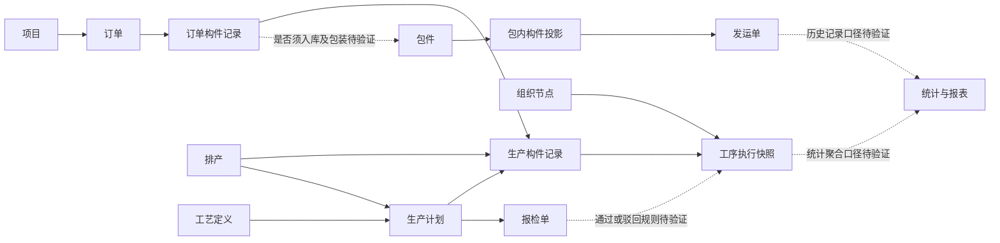

# 业务模块地图

日期：2026-11-06。引用约定：`L01 /n` 简写表示新采集文件的 `/requests/n`（从 0 起）；多项区间表示分别查看这些请求。证据 ID、等级定义见 [系统资产清单](system-inventory.md#8-证据索引)。以下模块是业务分析分组，属于**较高可信推断**，不声称等于原平台菜单、服务或数据库边界。

## 1. 模块与职责

| ID / 模块 | API 数 | 有证据的输入、输出及职责 | 业务对象 | 等级 / 证据 | 尚缺内容 |
|---|---:|---|---|---|---|
| M01 身份与组织 | 3 | 登录说明；当前账号返回 role、department、role_permission；组织接口返回 pid/children 树 | 组织、人员、角色/权限 | 已验证（本次查询）；L01 /requests/0..1。登录 API 本身仅文档记载 S01 | 权限后端执行、角色关系基数、停用约束 |
| M02 项目与设计资料 | 10 | 项目分页、选择项、项目构件聚合；旧文档列有资料与项目维护 | 项目、设计资料、订单构件投影 | 已验证（项目/构件样本）；L01 /requests/2..3、S13 /capturedApis/4。文件/写操作待验证 S02 §6.1 | 设计版本、解析产物、项目关闭与删除规则 |
| M03 订单与构件范围 | 10 | 订单归属项目，订单明细含构件属性及 scheduling_id/package_id/delivery_id | 订单、订单构件记录 | 已验证；L01 /requests/10..12。新增/导入能力待验证 S01 | “订单”是否销售合同、制造任务范围或两者兼有；提交/审核规则 |
| M04 排产与工艺配置 | 13 | 排产详情含 plan_id、design_id、departments；生产构件含 order_artifacts_id；配置投影含 branchs/column | 排产、工艺定义、工序节点、构件分配 | 已验证（结构）；L01 /requests/7..9。下发条件待验证 S01/S02 | 拆分/合并排产、一对多计划、工艺变更与适用特征 |
| M05 生产计划与任务视图 | 11 | 计划详情、计划构件、任务列表；任务样本复用计划 ID；下载资源在此归业务用途 | 生产计划、生产构件、任务候选视图 | 已验证（返回结构）；独立 Task 为待验证。L01 /requests/4..6、/18 | task_id 身份、下发/接收/完成、任务分派历史 |
| M06 过程执行 | 2 | 旧文档记录 updateProcess 与 cancelProcess；构件有 process_items、node_current、department_current、completed/time | 工序执行事实、部门分配 | 已验证（读取执行快照）；写操作和转移规则待验证。L01 /requests/6、S02 §6.5 | 扫码报工、撤销、补录、返工及节点跳过条件 |
| M07 报检与质量 | 6 | 报检主记录含 plan_id、提交/质检/探伤部门和人员引用、状态、hide | 报检单、检查结果候选 | 已验证（本次列表）；L01 /requests/17，仅当前部门可见 1 条撤销记录 | 明细身份、通过/不通过/复检、隐藏与删除差别 |
| M08 包装与发运 | 11 | 包件→包内构件，包件/构件持 delivery_id；发运单含编号、日期、车辆字段 | 包件、包内成员、发运单、交付事实 | 已验证（样本关联）；L01 /requests/13..16 | 包件唯一归属、直发、混单、撤回及计数差异 |
| M09 统计与报表 | 15 | 装焊统计用于本仓“入库”；发货历史查询用于出库；其余文档有汇总/下钻/月模板 | 指标、统计维度、模板候选、报表投影 | 已验证（本仓实现）；S08。其他接口待验证 S02 §7 | 每个统计口径、时间边界、去重键、实时/快照 |
| M10 文件解析与输出 | 11 | 旧文档上传、解析、导出/同步和任务单；本仓用 /delivery/info 读取 PDF | 文件资产、导入批次候选、下载资源 | 较高可信推断（代码/说明）；S01、S09。写接口待验证 | 版本、幂等、解析错误、文件关联与失效 |
| 合计 | 92 | 路径归类互斥；业务对象可跨模块 | — | 已验证（目录统计 X03） | 不含 21 个排除项 |

## 2. 核心流向与证据强弱

下图实线表示已有字段或样本联结，虚线表示仍需操作闭环确认；即使实线存在，也不自动证明关系基数、先后顺序或强制前置条件。

**已验证（样本）**：项目/订单/排产/计划/生产构件联结见 L01 /requests/4..12；包件/发运见 /13..16；报检计划引用见 /17。**较高可信推断**：物理构件贯穿这些记录，但仍需实体身份核验，不能把图中的多个资源直接合成一张表。

## 3. API 资源与模块边界不一致的地方

| 观察 | 等级 / 证据 | 分析结果 |
|---|---|---|
| v1.order 资源族同时承载订单、包件、发运历史 | 已验证；X03、L01 /requests/10..16 | 不按技术资源前缀直接划定一个“订单领域” |
| getProjectArtifacts 返回订单构件引用与排产信息 | 已验证；S13 /capturedApis/4 | 它是跨业务投影，不能据此新增一个“项目构件主实体” |
| getProductionArtifacts 与 getPlanArtifacts 样本 id 相同，但工序文字展示不同 | 已验证；L01 /requests/6、/9 | 同一生产构件有配置/执行两种表示；字段同名不保证语义完全相同 |
| getTasks 和 getPlans 样本共享 id、design_id、scheduling_id | 已验证；L01 /requests/4、/18 | 独立任务实体目前为待验证，不采用旧重开发文档中的 Task 主键假定 |
| 包件主记录具有 is_package=1、guid 和构件风格字段 | 已验证；L01 /requests/13..14 | “共用资源结构”不能推出包件是物理钢构件 |
| /delivery/info 返回 PDF 的读取逻辑存在 | 已验证（代码）；S09 L264 | PDF 是单据表示，不是新业务实体 |

## 4. 覆盖外的线索

**已验证（权限声明）**：L01 /requests/0 的 role_permission 含 `/design/process`、`/design/manage`、`/design/feature`、`/platform/person`、`/platform/jobs`、`/platform/permissions`、`/platform/welder`、`/subwork/index`、`/subwork/auto`、`/calculate/index`、`/rolling/index`、`/rolling/code`、`/transfer/index`、`/production/change` 等路由。

**待验证**：上述路由的实际页面、业务意义、接口和可用性没有在本次逐项操作。它们证明现有 92 个接口清单可能覆盖不全，不能仅凭英文路由把它们命名为分包、结算、轧制或调拨业务。VB-18 将先用页面标题、表单和实际响应识别这些模块。

**待验证**：采购、材料库存、合同、财务、安装、设备等钢结构企业业务是否在原平台内。当前缺少直接 API/页面证据，不在本阶段自行补建实体和模块。
