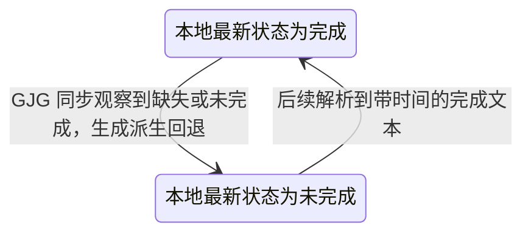

# 状态机及状态变化

日期：2026-11-06。引用约定：`L01 /n` 简写表示新采集文件的 `/requests/n`（从 0 起）；多项区间表示分别查看这些请求。证据索引见 [系统资产清单](system-inventory.md#8-证据索引)。本次没有提交任何生产状态更改。因此能确认的是**状态样本、配置图、已有执行痕迹和本地转换代码**，不能宣称已完成真实状态迁移验收。

## 1. 原生状态字段与已见值

| 对象 | 字段 | 已见值/配套文本 | 结论等级与证据 | 未确定 |
|---|---|---|---|---|
| 项目 | status / status_name / completed | 1 / 正常 / 0 | 已验证；L01 /3 | status 是否启停；completed 是否结项；完整枚举 |
| 订单 | order_status / order_status_name | 0 / 已排产 | 已验证；L01 /10..11，历史 S14 /capturedResponses/0 同样出现 | 不得解释为 0=未排产；其他值与转换 |
| 订单 | state / status / state_name | 1 / 1 / 正常 | 已验证；L01 /11 | 与订单生命周期、删除和审核的关系 |
| 排产 | scheduling_status / scheduling_status_name | 0 / 待开始；同时 plan_id=9155 | 已验证；L01 /7 | 待开始与已下发、计划开始的关系 |
| 计划 | production_status / production_status_name | 1 / 进行中；历史 2 / 已完成 | 已验证（本次/历史分别限定）；L01 /4..5、S12 /probeResults/3/firstSample | 1→2 的完成条件、其他枚举、归档 |
| 生产构件 | is_complete | 0；历史样本 1 | 已验证；L01 /6、S12 /4 | 全部节点完成还是结束节点完成；撤回语义 |
| 生产构件 | node_start/current/end | 1 / 42 / 25；历史 1 / 0 / 26 | 已验证；L01 /6、S12 /4 | node_current=0 的完整语义与空值约定 |
| 工序节点定义/显示 | state | 已开始和未完成节点均可为 success | 已验证反例；L01 /6/process_items | 是图形样式/配置标记的较高可信推断；不能当业务完成 |
| 工序节点执行 | completed / time / opt_user | 起点 completed=1 且有时间/操作者；其余节点缺这些字段 | 已验证；L01 /6 | 缺失不是完整的“未开始/撤销/不适用”枚举 |
| 构件发货显示 | is_deliver | “未发货”；历史为日期+【操作人】 | 已验证；L01 /6、S12 /4 | 非布尔；退货/撤回/重发表示 |
| 包件 | is_package / is_complete / delivery | 1 / 1 / 已发货；complete_time=0 | 已验证；L01 /14 | 各标志不宜互相替代；包装完成与生产完成区别 |
| 报检 | status / status_name / hide | -1 / 已撤销 / 0 | 已验证；L01 /17 | 撤销来源状态、审核、驳回/复检、隐藏规则 |
| 发运单 | status | 1 | 已验证；L01 /16 | 不足以命名为已签收、审核通过或正常发运 |

**已验证（组合反例）**：同一业务链的订单“已排产”、排产“待开始”、计划“进行中”、构件 node_current=42 同时存在（L01 /5..7、/11）。它们属于不同状态域，不能合并为一条统一生命周期数字序列。

## 2. 工艺配置图：已验证定义，未验证迁移守卫

L01 /requests/4/data/list/0/design_info 是 JSON 字符串，解析后为 design_id=31 的工艺定义。历史 S12 /probeResults/3/firstSample/design_info 提供相同节点/边结构。

**已验证（配置）**：lineList 包含 1→42→50→36→25；type 分别为 start/process/process/process/end。**待验证（运行约束）**：这些边是否全部强制执行、能否跳过、能否并行、如何回退和如何产生报检单。

| 节点 | quality | features_codes | 等级/解释 |
|---|---:|---|---|
| 1 钢构生产开始 | 0 | GJG, lsx, zh, FXC, ZFJ, PEC, qkc, xc | 已验证字段；不能直接解释为适用优先级 |
| 42 装焊报检 | 1 | GJG, lsx, zh, FXC, ZFJ, PEC | 已验证字段；quality=1 的正式字典待验证 |
| 50 装焊探伤 | 3 | GJG, lsx, zh, PEC | 已验证字段；FXC/ZFJ 未列入，推断存在条件选路，待操作确认 |
| 36 装焊质检 | 2 | GJG, lsx, zh, FXC, PEC | 已验证字段；不能推导 ZFJ 一定免检 |
| 25 涂装 | 0 | GJG, lsx, zh, FXC, ZFJ | 已验证字段；PEC 未列入，结束判定待验证 |

本表证据均为 L01 /requests/4/data/list/0/design_info/nodeList（先解析字符串）。**较高可信推断**：生产特征会影响工艺适用性。**待验证**：特征不在列表时究竟跳过、禁止下发还是采用其他流程。

## 3. 不同工艺与执行痕迹

**已验证（历史快照）**：S12 /probeResults/4/firstSample/process_items 中存在 1“钢构生产开始”、31“构件装焊”、25“涂装”、26“成品库”；不是上述 design_id=31 的同一套节点配置，不能把两个样本拼成一张通用状态机。

**已验证（字段）**：历史 `process_welder` 记录含 `process_from_id=1 → process_id=25`、`department_from_id=81 → department_id=70`，以及 `25→26`、`70→80`。这能证明记录中保存了来源/目标工序与部门的关联痕迹；**较高可信推断**是流程交接或转序记录，不能从单份快照证明用户点击顺序、守卫与全部事件历史。

**已验证（时间矛盾）**：该历史构件 is_deliver 文本为 2023-01-01，涂装与成品库完成时间为 2023-02-16。**待验证**：补录、迁移、更正或其他口径造成何种差异。此反例足以阻止直接将“所有业务日期严格按生产→入库→发货递增”写成既有规则。

## 4. 仍不能画成确定状态机的业务对象

| 对象 / 候选迁移 | 当前证据 | 结论等级 | 缺少的证明 |
|---|---|---|---|
| 订单：草稿→提交→审核→排产 | 只见已排产和创建/构件提交的旧说明 | 待验证；S01、L01 /11 | 是否存在草稿、提交是否审批、错误码和角色 |
| 排产：新建→下发→计划生成 | 文档有 sendProduce，双向 plan_id/scheduling_id 样本存在 | 较高可信推断（生成关系）；迁移待验证 | 操作前后快照、是否幂等、拆分重发 |
| 计划：进行中→已完成 | 本次/历史见到 1/2 两种状态，未观察同一对象变化 | 待验证迁移；状态值已验证 | 完成触发、是否自动、撤销后的恢复 |
| 报检：待检→合格/不合格→复检/撤销 | 只见已撤销单及检查/探伤字段 | 待验证 | 全部枚举、明细、审核命令、异常流程 |
| 仓储：未入库→已入库→已出库 | 本仓报表名称、complete_time_text/发货历史字段 | 待验证（仓储状态机） | 独立入库事件、仓库/库位、直发、库存扣增 |
| 包装：未包装→已装包→拆包 | 包件与成员样本及增删成员旧说明 | 待验证迁移 | 成员历史、互斥、删除、发运锁定 |
| 发运：创建→审核→发运→签收→撤回 | 单据查询/已发货文本 | 待验证 | 写 API、角色、签收、退货/更正、库存影响 |

## 5. 本地派生状态机：不得归为原平台规则

| 本地机制 | 已验证实现 | 证据 | 风险 |
|---|---|---|---|
| 项目分类 | 负责人含钢构在建→building；流水线→pipeline；完结库存0/已完结→closed；否则 null | S07 L342..366 | 这是文本分类，不是云端 status 的枚举 |
| 计划状态映射 | production_status_name 含完成/完工→completed，否则 producing | S03 L144..148 | 未知原生状态会被归入 producing，不能当完整字典 |
| 本地归档 | 完整同步范围内缺失的计划可标 archived | S03 L1136..1160、L1277..1303 | 不能证明云端执行了“归档”操作或物理删除 |
| 状态文本解析 | 时间戳判完成；括号提取班组/操作者；缺时间可用计划开始时间作事件时间 | S03 L431..623 | 补出的时间不是原始业务时间，必须记录来源 |
| 缺字段回退 | GJG 目标状态原本完成、API 当前未完成/缺失→生成 false 的回退事件 | S03 L630..678 | 事件时间为采集观察时点；未证明源系统用户撤销 |
| 历史快照 | 入库/出库 raw_value 保存 API 时点 JSON，本地报表优先读取 | S19；src/nightly-process-reconciliation.js、src/nightly-shipping-alignment.js | 是本仓留痕策略，不证明云端可还原历史 |

该图为**已验证的本地解析/同步机制**（S03），不是原平台 `cancelProcess/updateProcess` 的业务验收。下一阶段需分别建立“源状态事实”“配置迁移”“采集解释”，不可混为同一事件流。
