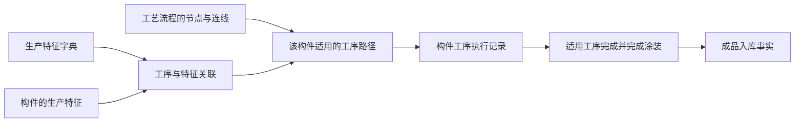

# 钢构核心业务本体评审稿 v0.4

日期：2026-11-06。范围：项目、订单、钢构生产、质量、包装发运。工艺、工序、生产特征及组织人员是这些业务的支撑配置。本稿只做分析，不定义数据库表，不开发平台。

## 1. 阅读顺序与结论等级

1. 本文：统一概念、实体关系与状态维度。
2. [工艺功能与源字段映射](process-and-source-map.md)：工艺模块已读取内容、实际样本、字段映射及限制。
3. [业务操作与验收场景](operation-contracts.md)：确认规则、待补的命令条件、可核对示例。
4. [阶段报告与剩余问题](review-status.md)：本轮成果、补采状态、下一阶段入口。

等级仍分**已验证、较高可信推断、待验证**。已验证必须标明是用户确认、接口样本还是代码/页面事实；用户确认的目标业务规则不冒充旧系统的实测实现。设计建议统一标为待验证，不反过来修改业务定义。

## 2. 已确认规则基线

| 规则 | 定义 | 证据与等级 |
|---|---|---|
| BR-01 | 首期为项目、订单、钢构生产、质量、包装发运 | 已验证〔用户确认〕；[前轮业务确认](../dongwu-business-confirmation-20261106/evidence/business-decisions.json) |
| BR-02/03 | 同编号补件或重制件是新构件；原构件生产状态封存 | 已验证〔用户确认〕；同上。封存的具体命令时点、解除和库存影响仍未确认 |
| BR-04 | 成品入库对应该构件应走工序全部完成，以涂装完成作为入库动作 | 已验证〔用户确认〕；前轮BR-04与本轮BR-07共同解释，不能再要求所有配置节点都必须执行 |
| BR-05 | 不设“装焊入库”业务概念；装焊报检是工序/质量过程 | 已验证〔用户确认〕；旧导出命名出处已查明，不能变成目标库存事件 |
| BR-06 | 流水线完成属于半成品完成，排除出本轮成品完成/入库映射 | 已验证〔用户确认〕；[本轮补充](evidence/user-clarifications.json) U04 |
| BR-07 | 工序可以跳过；发现场件不需要探伤 | 已验证〔用户确认〕U04；探伤关联配置和27条执行样本相互支持 |
| BR-08 | 每个构件走哪些流程，由生产特征及工艺流程、工序管理模块定义 | 已验证〔用户确认〕U05；工序目录、特征目录、关联页面已读取 |

BR-07不等于“任何人可以随意跳过任何工序”。已确认的是按业务与配置确定适用流程；临时人工豁免、角色和审批条件仍待验证。

## 3. 核心概念与资源身份

| 概念 | 业务角色与边界 | 身份/关系依据 | 等级 |
|---|---|---|---|
| 项目 | 组织订单、生产、质量和发运的业务范围 | 源project.id与各project_id引用；前轮实体目录 | 已验证〔接口样本〕；工程合同边界未等同 |
| 订单 | 构件需求与明细的业务单据 | 源order.id；订单构件order_id | 已验证〔接口样本〕；不假定等于商业销售合同 |
| 构件 | 企业管理的具体构件身份；同编号补制可为新构件 | BR-02；源订单构件/生产记录的映射 | 已验证〔用户确认〕身份原则；企业标识编码方案待设计 |
| 订单构件记录 | 构件在订单中的源明细表示 | 订单构件id、order_id、guid | 已验证〔样本〕；不能将打印合并行当成它的身份 |
| 生产计划/排产 | 组织执行范围与工艺选择 | 计划id、scheduling_id、design_id | 已验证〔样本〕；历史拆分/重排基数未定 |
| 生产执行记录 | 某构件在计划中的生产状态和节点执行观测 | 生产id、plan_id、order_artifacts_id、process_items | 已验证〔样本〕；不把一次源记录永久等同一件实物所有历史 |
| 生产特征 | 决定构件适用工序的业务分类配置 | getFeatures的id/name/code；构件“生产特征”值 | 已验证〔用户+配置〕；原始码存在大小写差异，映射保留证据 |
| 工序定义 | 可复用的工序，如装焊报检、探伤、质检、涂装 | getManages的id/name/type/quality；getManageFeatures关联特征 | 已验证〔目录/关联页面〕 |
| 工艺流程 | 工序节点及有向连线组成的配置图 | design.id、info/nodeList/lineList；计划design_info | 已验证〔配置〕；不可变版本及历史绑定策略仍待验证 |
| 工序适用关系 | 某生产特征与某工序的关联 | 工序特征管理页面、getManageFeatures、节点features_codes | 已验证〔用户+配置〕；当前配置不能自动覆盖历史执行依据 |
| 工序执行事实 | 对构件某适用节点的完成、时间、操作者等观测 | process_items[].completed/time/opt_user等 | 已验证〔快照〕；不声称已有完整不可变事件日志 |
| 报检单及成员结果 | 组织提交与质量结果，成员可来自多个计划 | 报检id、成员生产引用、inspection_status | 已验证〔前轮详情〕；单头汇总与混合结果规则仍未穷尽 |
| 原构件封存与补制来源关系 | 原状态保留，新构件独立推进，并保留与原件关系 | BR-02/03 | 已验证〔用户业务定义〕；原API表达方式尚无直接证据 |
| 成品入库事实 | 对满足BR-04的构件记录完成事实 | 构件、适用流程、涂装执行证据 | 已验证〔用户定义〕；原字段映射按工艺类型限定，不直接等于is_complete |
| 包箱、成员、发运单 | 包装归组及发运；计量层级不同 | package.id、成员id/package_id、delivery_id | 已验证〔前轮接口/PDF〕；包箱可跨订单，计数不可直接混加 |
| 组织、人员与角色 | 分工、执行和授权的支撑信息 | department/user/role引用、页面范围 | 已验证〔声明与样本〕；后端动作权限未实测 |

任务列表、当前任务、我的任务、生产变更列表、选择项、PDF合并行、统计表是视图或输出表示，不能仅因各有API/菜单就建立独立主实体。前轮8479/8432全量对照及PDF分组是其证据，见[异常核对报告](../dongwu-exception-audit-20261106/exception-report.md)。

## 4. 工艺配置机制

**已验证〔用户确认及配置/样本〕**：应先确定构件生产特征，结合其工艺图和工序关联配置，识别应执行的工序，再解释执行记录。不能把所有构件固定为“报检→探伤→质检→涂装”。

图是业务机制表达，不是已经验证的服务器内部算法。图路径如何跨越不适用节点、配置更改何时生效等实现细节仍待验证。

已验证的FXC样例：生产特征目录中FXC为“发现场散件”；探伤工序50的关联列表不含FXC，涂装工序25包含FXC。计划9097的27条构件原始特征为小写`fxc`，开始、报检、质检、涂装均有完成记录，探伤无完成记录，源构件is_complete=1。这与用户说明相符；不能把探伤空记录错误判成漏检或未完工。

**较高可信推断〔映射〕**：该样本的小写fxc对应目录FXC。保留原码及映射依据；不据此假定所有接口、所有特征码都大小写无关。

## 5. 状态分层

以下分层是**待验证／模型建议**，用于准确承载已确认业务；不是声称原系统已经有对应枚举。

| 维度 | 需要表达什么 | 与其他维度的区别 |
|---|---|---|
| 工序适用性 | 应执行、不适用、依据待查 | 不适用不等于“执行后完成”；缺失记录不自动等于不适用 |
| 工序执行情况 | 待执行、已有完成证据、异常/待核对 | 必须结合适用性；state=success不是可靠完成依据 |
| 构件生产进度 | 按该构件适用流程判断生产中/完成 | 计划单头production_status不能替代各构件状态 |
| 生产状态封存 | 保留原构件当时状态，新构件不覆盖它 | 封存与原进度同时存在；不自动触发报废、退款或发运撤回 |
| 成品入库事实 | 适用工序完成、涂装完成；记录来源和时点 | 排除流水线半成品完成；清库存/旧成品库另做历史映射 |
| 质量结果 | 报检成员、探伤、质检的结果及证据 | 发现场件不适用探伤，不应强制生成“探伤通过”结果 |
| 包装/发运 | 包内成员、发运单与发生时点 | 已发运不是已签收；推算到达时间不是原生事件 |

**待验证／概念判定式**：成品入库成立，需要“构件属于本轮成品业务范围 + 适用流程依据已知 + 应执行工序有完成证据 + 涂装完成”。配置明确不适用的探伤不阻断；配置缺失、特征未知、人工豁免无证据时标为待核对，不把空值直接当跳过。

该判定式表达目标业务，不可直接用于自动改写历史库存。历史字段含义不同、时间缺失、清库存调整必须保留原值并单独核对。

## 6. 核心关系与约束

| 关系/原则 | 当前依据 | 结论等级及边界 |
|---|---|---|
| 生产执行记录→订单构件 | order_artifacts_id明确联结；本轮75条及前轮408条样本 | 已验证〔样本〕；不扩大成全历史唯一关联保证 |
| 构件→生产特征→适用工序 | 用户说明+字典/关联配置+执行样例 | 已验证〔机制〕；版本生效与组合特征逻辑仍待验证 |
| 原构件→补件/重制新构件 | BR-02/03 | 已验证〔用户〕；源关联字段、次数/基数和触发时点待验证 |
| 报检单→多个计划的成员 | 前轮34056跨计划8939/9016 | 已验证反例；不得限制单张报检只能一个计划 |
| 计划→多个订单的成员 | 本轮计划4362含4个订单，C01 `/requests/9/data` | 已验证样本；订单不宜强制作为计划唯一外键，普通钢构新建规则另核对 |
| 包箱→多个订单成员 | 前轮1614199/1614198 | 已验证反例；项目边界、一件多包和成员历史仍待验证 |
| 打印行→多个源构件记录 | 前轮PDF数量4/3/6分组 | 已验证；打印行不是物理构件身份 |

本轮确认的是业务本体及证据边界。状态字段、功能入口及写操作不能因为“存在”而自动认定权限、审核和副作用已验证。详细操作合同见下一份文档。
