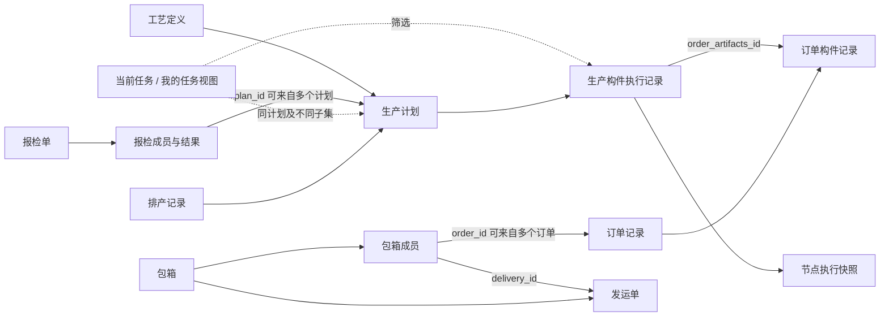

# 业务本体草案 v0.1

日期：2026-11-06。本文是业务分析模型，不是数据库设计或新平台实现。证据 E01～E11 的文件链接和定位约定见 [探索报告](exploration-report.md#5-证据索引)。拟议名称与建模措施均标为待验证，不冒充原系统术语。

## 1. 概念分层

| 层次 | 概念与证据等级 | 使用原则 |
|---|---|---|
| 企业业务概念 | 项目、生产组织、工艺、报检、包装、发运存在：已验证（E01/E04 页面及响应）。物理构件身份跨系统连续性：较高可信推断（E06 与 E02 的 408 条关联） | 企业术语不以资源名自动决定；源“订单”是否商业合同订单仍待验证 |
| 源业务记录 | 订单构件记录、排产、生产计划、生产构件记录、报检单、包箱记录、发运单：已验证（E02/E03/E06/E10） | 各自保留源标识；记录并不必然等于独立现实物体 |
| 业务关系及观测 | 计划内构件、报检成员、包内成员、节点执行快照：已验证结构（E02/E03/E05） | 关系有效期、撤回历史和不可变事件性尚待验证 |
| 查询与展示 | 当前任务、我的任务、全部任务、选择项、统计明细、工艺图渲染元数据：已验证（E01/E04/E07） | 不因为有独立 API 就建立独立业务主实体 |

## 2. 身份与属性目录

表中“建议键”均为**待验证／设计建议**；原系统字段出现本身为已验证，不等于已证明唯一性或数据库外键约束。

| 概念 | 已观察标识与关键属性 | 建议身份及证据边界 |
|---|---|---|
| 项目 | id、name、code；下游 project_id/proj_id；E10 `/requests/2,3` | 源项目 ID；不把名称或负责人分类标签当身份 |
| 订单记录 | id、project_id、code、category、order_status；E10 `/requests/10,11` | 源订单 ID；商业合同、客户、结算关系待验证 |
| 订单构件记录 | id、order_id、project_id、guid、name、scheduling_id、package_id、delivery_id、is_package；E06 `/requests/0..3` | 独立于生产构件 ID。资源中含包箱标记，不能全部映射为物理构件 |
| 物理构件 | 名称/编号、规格、数量、重量、特征、部位；E06 与 E02 | 连续身份尚待验证；本轮 408 行 num=1，不覆盖数量大于 1、拆并或重制。保留候选身份映射，不设 GUID 全局唯一 |
| 排产记录 | id、plan_id、design_id、is_produce 查询范围、scheduling_status；E02 `/requests/5`，E10 `/requests/7` | 与生产计划分开；样本关联不证明永久一对一 |
| 生产计划 | id、scheduling_id、design_id、design_info、production_status；E02 `/requests/6,8,10,12` | 以源计划 ID 标识；不把每个任务视图的 id 复制为另一个业务身份 |
| 生产构件执行记录 | id、plan_id、order_artifacts_id、order_id、project_id、node_current、department_current、departments、is_complete、process_items；E02 `/requests/7,9,11,13` | 以源生产构件 ID 标识；与物理构件之间是否永远一对一待验证 |
| 工艺定义及节点 | design.id、name、info.nodeList/lineList；节点 id/type/quality；E03 `/requests/1..3` | 节点身份暂以“来源工艺表示+节点 ID”组合，避免未验证的全局唯一；设计版本机制待验证 |
| 节点执行观测 | completed、time、department、opt_user、node_current；E02 的构件 process_items | 不是已证明的事件日志。建议保留采集时点和原始快照；缺值、跳过与撤销不可合并解释 |
| 报检单 | id、code、plan_id（可逗号分隔多个值）、project_id、artifact_count、status、submit/inspection/flaw 字段组；E02 `/requests/14..16`，E05 `/requests/2..3` | 源报检单 ID；计划关系从头和成员共同验证，不能强制单计划 |
| 报检成员及结果 | list[].id、plan_id、order_artifacts_id、inspection_status、inspection_status_name；同上 | 较高可信推断：list[].id 指生产构件身份；未见独立检查结果键。建议暂保留“报检单+成员源引用+快照”而非发明 result_id |
| 包箱 | id、guid、is_package=1、delivery_id、artifacts_count、order_id=0；E03 `/requests/4,6,8` | 现实归组概念与源资源类型分开；字段同构不能证明后端实际共用数据库表 |
| 包箱成员 | 返回 id、order_id、guid、count、weight、delivery_id；出库记录另有 package_id；E03 `/requests/5,7,9,11` | 以成员源 ID 建关系；是否允许同时属于多个有效包、是否保存成员历史待验证 |
| 发运单 | id、code、artifacts_count；E01 `/requests/18`，E10 `/requests/16` | 计数对象尚未统一；发运完成不等于签收、安装完成 |
| 组织/参与者 | department、departments、各 user/sign 引用；E04 `/requests/0`、E10 `/requests/0,1` | 区分账号、人员和组织；签名/外部对象的目标类型仍待验证 |

**待验证／建议**：跨源身份注册采用 `(source_system, resource_kind, source_id)`；GUID、编号、名称保留为带来源的属性。内部是否另设企业构件唯一标识，应在业务方明确重制、补录、拆并和批量行语义后决定。

## 3. 可追溯关系与基数

| 关系 | 等级、证据 | 可采用的结论 | 不可采用的约束 |
|---|---|---|---|
| 生产构件 → 订单构件 | 已验证：E09 `identityJoins`，对应 E02/E06 | 本轮 408/408 显式引用匹配，项目/订单/GUID一致；可用此方向定位源记录 | 全历史必有目标；一个订单构件永远只有一条生产记录 |
| 生产构件 → 计划 | 已验证：E02 四组明细中的 plan_id | 样本明细归属相应计划 | 重排时 ID 是否保留、跨计划历史是否合并 |
| 排产 ↔ 计划 | 已验证样本：E10 `/requests/7` 与 E02 `/requests/6`；9504↔9155 | 双向引用存在 | 强制 1:1、不可重复下发、不可拆分 |
| 任务视图 → 计划和构件子集 | 已验证：E04 `/requests/1..8`、E05 `/requests/0..1` | 9081 的 current⊆my⊆全部；8⊆68⊆167 | all 任务列表与计划列表全量相等；部门规则即后端授权规则 |
| 报检单 → 多个计划的成员 | 已验证：E02 `/requests/14/data` | 单张 34056 已跨 8939/9016 两计划；排除“最多一计划”约束 | 任意跨项目合并；结果可任意拆分；全历史成员唯一 |
| 包箱 → 多订单成员 | 已验证：E03 `/requests/7,9` | 两个包箱分别跨两订单；排除“必须同一订单”约束 | 任意跨项目；一构件可重复入包；包件嵌套允许 |
| 包箱/成员 → 发运单 | 已验证：E03 `/requests/4,5,11` | 1622105 和 26 个成员均引用 8514，出库历史同组 | 每包永远只发一次；撤回后历史如何变化 |
| 工艺图 → 执行记录 | 已验证结构：E02 的 design_info/process_items；E03 工艺主记录 | 配置节点与构件执行字段存在对应 | 每条配置边都是必经转换；features 缺失即执行禁止 |

下图只画已观察关联方向和视图，不表达全局基数；“物理构件”连续身份及其映射仍为较高可信推断，未硬连成等号。

## 4. 建模约束登记

| 编号 | 约束或原则 | 等级与处置 |
|---|---|---|
| C01 | 编号/GUID 可直接作为企业全局唯一主键 | 待验证；不采用。上一阶段已有同编号多 GUID 反例；本轮包内 T3-23GL-5 也有多条不同 ID/GUID，E03 `/requests/5/data/samples` |
| C02 | 报检单最多关联一个生产计划 | 已验证不成立：34056；禁止采用 |
| C03 | 包箱必须属于唯一订单 | 已验证不成立：1614199、1614198；禁止采用 |
| C04 | 所有接口中数字 0/1/-1 含义相同 | 已验证不成立：状态字段与筛选哨兵各有上下文；见状态模型 |
| C05 | current/my 的数量可以与完整计划数量直接对比为缺失 | 已验证不成立：9081 的范围不同；先保存查询上下文 |
| C06 | `state=success` 表示工序已完成 | 已验证不成立：配置及未完成节点也为 success；E09 `designs` |
| C07 | 发运明细数量总是 `artifacts_count-1` | 待验证；禁止采用。只确认三个差一计数样本和其中一个完整出库对照 |
| C08 | 当前工艺主定义可覆盖全部历史计划图 | 待验证；不采用。计划有展开字段且历史设计不同，版本/动态展开策略未知 |
| C09 | API 空列表证明业务不存在 | 已验证不成立：排产 is_produce=0/1 与报检范围反例；E01/E02 |
| C10 | 读快照可还原完整状态迁移与权限 | 待验证；不采用。需要时间序列、操作响应及角色测试 |

## 5. 下一轮概念评审输入

以下为**待验证／建议**，不是要求立即回答所有问题：

1. 先用 408 条匹配样本、多计划报检单、跨订单包箱解释概念边界；业务方确认“订单、构件、任务、入库”的企业术语。
2. 用数量大于 1、同编号多 GUID、重排/返工样本校验物理身份和计量单位；未通过前保留源记录，不强制合并。
3. 将状态规则做成证据登记表，写明前后状态、参与角色、触发操作和反例。只读探索继续推进；实际创建/审核/撤销验证另选可控测试对象。
