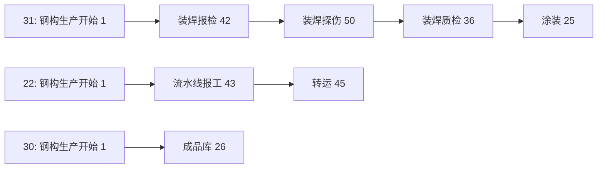

# 状态、工艺与操作模型

日期：2026-11-06。所有证据编号见 [探索报告](exploration-report.md#5-证据索引)。本轮未操作新增、审核、拒绝、删除、撤销、回退、报工或发运按钮。页面显示某命令和服务端允许该命令，是不同结论。

## 1. 已核对状态字典

| 对象与字段 | 已观察值及标签 | 等级、证据与边界 |
|---|---|---|
| 计划列表筛选 `production_status` | -1 全部；0 待生产；1 生产中；2 已结束 | 已验证前端选项：E07 F01。响应/详情对 1 显示“进行中”，已完成样本可能显示“已完成”；保存各自词汇，不覆盖成一个未经确认的生命周期术语 |
| 排产列表筛选 `is_produce` | 0 未下发生产；1 已下发生产 | 已验证：E07 F07/F08、E01 `/requests/11`、E02 `/requests/5`。该字段不同于排产 `scheduling_status` |
| 报检列表筛选 `status` | 空串 全部；0 待检查；1 质检通过；2 质检拒绝；3 探伤完成；4 探伤拒绝 | 已验证前端选项：E07 F13。API status=3 的样本标签是“探伤通过”，不能由 UI“完成”推导任意结果 |
| 报检单响应 `status/status_name` | 0 待检查、1 质检通过、2 质检拒绝、3 探伤通过、4 探伤拒绝 | 已验证实际详情：E02 `/requests/14..16`、E05 `/requests/2..3` |
| 报检单响应 `status=-1` | 已撤销（上一阶段样本） | 已验证响应样本：E10 `/requests/17`。但本轮查询参数 -1 返回全部口径（E03 `/requests/0`），不能拿同值直接定位撤销单 |
| 报检成员 `inspection_status` | 0 对应标签“-”；1/2/3/4 对应质检通过/质检拒绝/探伤通过/探伤拒绝 | 已验证：E09 `inspectionDetails`。成员 0 的显示标签不同于头部“待检查”。本轮各单内结果一致，不证明混合结果如何汇总 |
| 库存/物流历史查询 `type` | 0 未入库；1 未发货；2 已入库；3 已出库 | 已验证页面选项：E07 F10。它是查询类别，不是已经证实按 0→1→2→3 流转的实体状态 |
| 构件 `is_complete` | 0/1；9081 明细 135 条 0、32 条 1 | 已验证：E02 `/requests/9`。完成判定的服务端条件、撤回副作用仍待验证 |
| 节点 `state` | success | 已验证配置值，未完成节点也出现：E02 明细、E09 `designs`。不作为完成判断 |
| 节点 `completed/time/opt_user` 与 `node_current` | 存在已完成/未完成字段差异及执行时间、操作者、当前节点 | 已验证结构：E02 四个计划明细。缺失字段是否跳过、隐藏或撤销不能自动认定 |
| 包箱/构件物流显示 | delivery 已发货、delivery_id 非零；历史 type=3 的成员引用发运单 | 已验证：E03 `/requests/4..11`。未验证签收/安装状态及发运撤回 |

订单 `order_status`、项目 `status/completed`、排产 `scheduling_status`、计划 `state/status` 等仍沿用上一阶段的有限样本，不将这里的字典复制给它们。未知值必须保留原码和原文，列为待验证。

## 2. 工艺配置图与适用特征

**已验证配置**：E03 `/requests/1..3/data/info` 的解码结果分别是下图三条图结构。它们表达工艺定义，不是本轮亲历的状态转换。

**已验证配置差异**：旧计划 163 使用 design_id=1，其图为 1→31（构件装焊）→25（涂装）→26（成品库），E02 `/requests/12/data/design_info`。因此不能把当前 design 31 的五个节点推广到历史全部计划。

下表是计划 9155/9081 展开工艺里的 `features_codes` 成员关系，均为**已验证配置**，不是执行守卫的实际测试结果。证据：E02 `/requests/6,8/data/design_info` 解码 `nodeList`；E09 `designs`。

| 节点 | GJG | FXC | ZFJ | PEC | WX | 其他代码 |
|---|---|---|---|---|---|---|
| 1 开始 | 有 | 有 | 有 | 有 | 有 | lsx、zh、qkc、xc |
| 42 装焊报检 | 有 | 有 | 有 | 有 | 无 | lsx、zh |
| 50 装焊探伤 | 有 | 无 | 无 | 有 | 无 | lsx、zh |
| 36 装焊质检 | 有 | 有 | 无 | 有 | 无 | lsx、zh |
| 25 涂装 | 有 | 有 | 有 | 无 | 有 | lsx、zh |

**较高可信推断**：特征配置参与适用节点选择。**待验证**：特征不包含某节点时如何跳转、PEC 不含终点 25 如何结束、零节点/无适用结束节点是否允许、quality 与报检过程的精确关系。不能从数组成员关系推导服务端强制约束。

**已验证**：设计主记录 31 的 `info` 仅含图结构和 quality 等字段，计划 `design_info` 多出 features 信息；设计外层 name 与图内 name 不同。是否为动态展开、创建时快照或历史版本仍为**待验证**，不得因名称差异认定发生版本切换。

## 3. 质量状态与已存在的时间证据

| 报检单 | 已观察快照 | 可以与不可以得出的结论 |
|---|---|---|
| 34056 | status=0，5 个成员，跨两计划；flaw_time=0、inspection_time=0；E02 `/requests/14` | 已验证提交后当前未有这两类时间记录；不能由 0 推断“不需要探伤” |
| 34053 | status=3，2 个成员均探伤通过；flaw_time 非零、inspection_time=0；E02 `/requests/16` | 已验证探伤已有结果、质检字段仍未记录；后续是否必须质检待验证 |
| 34054 | status=1，3 个成员质检通过；探伤与质检均有时间，flaw_time=1793883160，inspection_time=1793885996；E02 `/requests/15` | 已验证该单记录中的探伤时间早于质检；较高可信推断存在先探伤后质检路径，但未观察同一单的 0→3→1 实时状态变化 |
| 33407 | status=2，2 个成员质检拒绝；两个阶段均有时间，质检描述“截面小，校正”；E05 `/requests/2` | 已验证存在质量拒绝及原因字段；不能证明返工单、复检次数或重新提交规则 |
| 30613 | status=4，1 个成员探伤拒绝；flaw_time 非零、inspection_time=0；E05 `/requests/3` | 已验证探伤拒绝快照；拒绝后节点回到哪里、是否允许涂装待验证 |

拟议候选迁移为 `待检查 → 探伤通过 → 质检通过`，以及探伤/质检拒绝分支，等级均为**较高可信推断**，仅用于安排验证。不能把不同对象的快照拼成已验证的完整状态机。撤销、复检、返工、跳过及部分通过的迁移边均为**待验证**。

## 4. 业务操作证据矩阵

| 操作/能力 | 已见证据 | 当前可确认等级 | 尚缺内容 |
|---|---|---|---|
| 查询计划与任务范围 | 真实页面路由、getPlan/getPlanArtifacts/getTaskArtifacts 和完整返回；E04/E05 | 已验证：只读调用成功、不同范围得到不同子集 | 对其他角色是否相同；完整授权条件 |
| 查询报检及构件结果 | 真实详情页与 5 张单据；E02/E04/E05 | 已验证：结果与字段存在 | 明细可否独立审批、混合结果汇总方式 |
| 查询工艺定义 | 工艺列表、设计页 getDesignMenu、getDesign；E01/E03/E04 | 已验证：定义、节点及候选菜单存在 | 保存时校验、引用后变更是否影响历史 |
| 属性变更、转移/修改生产部门 | 计划 9081 页面按钮；E04 `/pages/0/bodyText` | 已验证：界面入口；效果待验证 | 目标范围、源记录如何变化、角色权限 |
| 过程回退、过程更新、撤销生产 | 计划页/当前任务页按钮；E04 `/pages/0..1/bodyText` | 已验证：入口；迁移规则待验证 | 前后节点、是否回滚报检/库存、是否保留历史 |
| 编码/任务单下载 | 计划、任务、报检详情页入口；E04 页面文本 | 已验证：入口；本轮未验证输出文件 | 下载内容、模板版本、导出权限 |
| 删除包箱 | E07 F09 的确认文本说明删除后构件移出包箱 | 已验证：前端提示；实际级联和服务端保护待验证 | 已发运包箱能否删、成员 package_id 如何变化、软删/硬删 |
| 工艺保存/编辑 | E04 `/pages/5/bodyText` 的保存流程、编辑入口 | 已验证：入口；本轮未提交 | 并发编辑、版本、历史引用、无结束节点校验 |
| 新增、修改、删除、报工、审核/拒绝等其他命令 | E08 前端声明与上一阶段文档 | 路径声明已验证；业务语义、可用性和效果待验证 | 真正表单字段、命令参数、返回值、错误码、幂等和副作用 |

“按钮可见”不代表后端允许；“POST”也不代表业务写入，本轮大量读取采用 POST。业务动作判断应由触发页面、请求语义、返回和前后事实共同确定。

## 5. 库存、数量、重量与时间

- **已验证**：项目 140、2026-11-06，type=2 返回 size=43、weight=56809.6400；type=3 返回 size=26、weight=36201.2100。两个请求 start_time=end_time=1793894400，实际仍返回当天白天记录。E03 `/requests/10..11`。可确认本次接口按日期作了处理；跨日端点是否包含、时区和服务端归一化公式仍为待验证。
- **已验证**：包箱 1622105 的 26 条成员数量全为 1，weight 十进制求和为 36201.21，等于出库历史汇总；E09 `shippingComparison`。此例不涉及数量大于 1，不能确定是否应按 `weight×count` 求总重；原始单位契约、舍入阶段仍待验证。
- **已验证**：包箱头本身 `is_complete=1` 且 `complete_time=0`，E03 `/requests/4`。不能把所有资源的 is_complete/complete_time 都解释成同一实物完工事件。
- **待验证**：“已入库”与实际仓储收货是否同一事件。历史页的名称、工艺“成品库”、本地统计“装焊入库”是三个不同证据语境，不能先合并成一个库存状态。上一阶段本地“装焊入库”取装焊报检统计，证据见 E11 S08。

## 6. 后续验证用例（待验证／建议）

1. 在可控测试对象上记录每个命令的对象 ID、角色、前状态、请求、响应、后状态及上下游引用；包括拒绝→重提、完成→回退、发运→撤回。
2. 选 FXC/ZFJ/PEC/流水线与数量大于 1 的样本，验证配置适用、结束条件、重量与数量，而非只验证 GJG 正常路径。
3. 同一对象换两个业务角色读取，再在测试环境验证写授权。将“页面筛选、对象读取授权、动作授权”分别记录。
