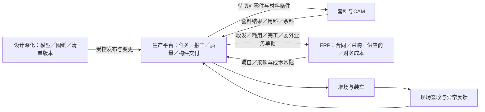

# 东吴云生产平台：钢结构 MES／ERP 行业对标与优化建议

日期：2026-10-26  
用途：供企业负责人和重新开发平台的软件公司讨论业务范围、优先级和验收要求。本文是研究与产品建议，不是已批准的开发需求。

## 1. 我的判断

东吴云已经具备项目、构件、订单、排产、生产、质检、打包发货和统计的业务骨架。重新开发时，最值得投入的是把这些模块之间的身份、版本、时间、数量和异常处理接通，使系统能可靠回答：

1. 这件构件对应哪版图纸，材料从哪里来，现在在哪里？
2. 某个安装批次还缺什么，为什么缺，谁负责，何时能齐套？
3. 今天报了多少、实际做了多少、合格了多少、发了多少，这几个数为什么不同？
4. 图纸变更、返工、撤销、补录以后，库存、计划、成本和历史报表如何一起调整？
5. 一个项目预计花多少钱、已经花多少钱、还有多少在制品和未结算委外？

建议把新平台定位为“钢结构生产与交付业务核心”，衔接设计／拆图、套料软件和财务 ERP。实施初期先把一条项目生产交付链做准，再扩展材料和成本。

## 2. 调研范围与证据边界

本次选取有可阅读产品资料或具体应用案例的代表系统，未找到足够可靠的行业装机量统计，因此不作“市场占有率排名”或“行业使用最多”的断言。

| 系统或路线 | 已阅读的资料及能力 | 值得借鉴的重点 | 证据限制 |
|---|---|---|---|
| Tekla PowerFab | 官方产品页覆盖估算、项目计划、图纸管理与变更、材料优化、采购、库存、生产、质量追溯、发运和看板，并列出设计、套料及设备集成方向 | 将图纸、材料、车间与交付放进同一业务链；按项目和产能安排工作；计划与实际成本比较 | 产品介绍证明供应商提供这些能力，不证明所有能力都在标准许可中，也不是国内普及率证明 |
| STRUMIS | 官方介绍钢结构制造 MRP、估算、文档、采购、库存、生产、条码及成本；库存模块明确提到到货与采购单核对、材料证书、余料及真实板材余料形状回库 | 钢材实物管理、余料再利用、批次追溯、多项目共享资源 | 具体实施颗粒度、接口与价格需另行确认 |
| 用友 U9／U9 cloud 路线 | 亿格科技发布的中润钢构案例：项目号贯穿销售、采购、生产和成本；项目专用料；钢材双计量；委外与受托加工 | 项目成本、采购与财务衔接、公斤与张数并存、在制品核算 | 来源是服务商案例，不是独立效果审计；文中宣传性降本比例不作为本项目收益依据 |
| 金蝶云星空路线 | 金蝶开发者社区实践文章比较三家钢材相关制造企业的管理方式，涉及理重／实重、多计量单位、整板领用、项目消耗、余料与财务核算 | 现场实物流转和财务成本口径要分别定义，再自动衔接；录入负担必须可承受 | 属于社区实践经验，且包含船舶配件、机械等相邻行业，不等于钢结构建筑企业普及率或产品开箱即用能力 |

ERP 主要承接合同、采购、供应商、成本和财务；MES 主要承接生产执行、工序、质量和追溯。钢结构专用软件常跨越两者。Tekla Structures 等设计／深化工具负责模型与清单，不能直接当作 MES。套料／CAM 工具负责切割优化和加工文件，也应明确接口边界。

## 3. 东吴云现有基础：哪些可继承，哪些还需核实

依据此前对东吴云网页前端、接口调用和部分登录态只读响应的调查：

| 已观察到的基础 | 优化应着重检查的关系 |
|---|---|
| 项目、设计文件、项目构件、订单及订单构件 | 同一实物在各模块是否具有稳定身份；同构件编号多件如何区分；版本变更是否保留历史 |
| 排产、生产计划、生产任务、工序更新与撤销入口 | 工序前置条件、并行加工、撤销后的下游影响、补录时间如何处理 |
| Excel 解析、构件信息、任务单与二维码导出相关接口 | 重复导入是否产生重复构件；导入差异是否可预览；二维码能否贯穿全部阶段 |
| 生产检验模块 | 不合格、返工、复检、批准放行与发货之间是否形成闭环 |
| 打包、发货、历史记录 | 是否支持安装批次齐套、实物定位、装车防错和现场签收 |
| 综合、班组、构件、质量、发货及月／日等统计入口 | 各表时间、构件范围、重量、撤销和历史修订口径是否统一 |
| 部门树与角色权限 | 更正、质量放行、跨项目调料等关键动作是否有独立权限与审计 |

这些观察不等于所有业务规则已经实测。例如，观察到工序更新和撤销接口，不能据此认定所有工序严格串行；存在质检菜单，也不能据此认定已实现返工闭环。

本文以下内容均为建议。未观察到的能力标为“待核实”，不直接认定东吴云没有。此前《重开发数据流转说明》中的建议性数据结构和校验规则，也不能倒推为现有平台的既成事实。

## 4. 优先建议一：统一构件身份，并管理图纸和清单版本

**解决的问题：** 同一个构件在项目、订单、排产、报工、包装中反复出现，必须知道这些记录是否指向同一实物。图纸改版后，还要知道哪些已经采购、下料、加工或发货。

**建议新增或补强：**

- 区分“构件编号／规格类型”和“实际第几件”。例如 GZ-01 共 20 件，关键构件应能追踪到具体实物；普通小零件可按批次管理，避免全部强制单件扫码。
- 定义项目—安装区域／楼层—安装批次—构件实物—零件清单关系；订单、任务、包装引用同一构件身份。
- 维护图纸号、版本、模型标识映射、零件清单版本、生效时间、批准人和变更原因。模型标识变化时也要能做新旧映射。
- Excel 或模型重新导入先生成差异清单：新增、删除、数量改变、材质改变、尺寸改变、重量改变；由业务人员确认影响。
- 按未投产、已领料、已下料、在制、已完工、已发货分别处理变更。暂停受影响任务，给出返工、报废、让步接收或现场处理决定，不直接覆盖旧数据。

**建议校验：** 同一导入批次重复提交不能重复建件；已执行的任务必须保留当时使用的版本；已发货构件的变化必须形成变更处置记录；跨项目相同编号不能混为同一构件。

**新增报表：** 图纸变更影响清单、旧版在制品清单、变更返工与损失统计。

**优先级：P0。** 这是二维码、齐套、追溯和历史报表的共同基础。实施难点是历史数据映射，不是二维码生成。

## 5. 优先建议二：先把时间、撤销和报表口径统一

**解决的问题：** “今天做的”“今天补录的”“今天审核的”“今天发走的”是不同业务事实。只看记录最后更新时间，会让历史日报、月报和库存对不上。

**建议每条关键业务记录保留：**

| 数据 | 含义 |
|---|---|
| 实际发生时间 | 工序完成、检验、入库、发运等业务真正发生的时间 |
| 系统记录时间 | 录入或接口收到数据的时间 |
| 审核／生效时间 | 需要审核时，业务正式生效的时间 |
| 更正／撤销记录 | 谁在什么时候因为什么，修正了哪条原记录 |
| 关联对象与版本 | 项目、构件／批次、任务、工序、班组、图纸版本 |
| 数量与计量口径 | 件数、理重、实重及单位；返工量单列 |

不用为了这些字段把系统做成复杂的技术架构，但必须保留可追溯的业务流水，不能仅保存一个随时被覆盖的“当前状态”。

例如：10 月 25 日完成 10 件，26 日补录。按发生日期统计，计入 25 日产量；按录入日期统计，列入 26 日补录情况。已经发布的 25 日日报保留原版，并生成修订版或差异说明，不能悄悄改变。

**必须提前约定的规则：**

- 夜班跨零点按哪个生产日归属，工厂使用哪个时区。
- 本期发生量和截至期末累计量分别如何计算。
- 工序产量、最终完工量、质检合格量、入库量、发货量分别统计，不能把各工序吨数相加当成最终成品吨数。
- 构件理重改变后，历史产量按业务发生时版本还是批准后的追溯修订统计；两种视图都应有明确标签。
- 撤销采用可追溯的作废／冲销关系；关联的下游记录进入复核或处理流程。
- 财务结账后的调整遵循 ERP 期间规则，经营报表的追溯修订与财务过账分开。

**建议校验：** 同一业务请求重试不能重复计产；每个汇总数能钻取到明细；汇总和明细使用同一范围与公式。报表导出保存筛选条件、生成时间、口径版本及数据截止时间。

**新增报表：** 补录及更正清单、已发布报表差异、跨表对账异常、期初—变动—期末库存表。

**优先级：P0。** 直接对应此前关注的数据时间流转和网页报表生成逻辑。

## 6. 优先建议三：按安装批次管理交付齐套

**解决的问题：** 完成吨位很高，不代表现场能安装。假设一个吊装单元需要 100 件，已经完成 98 件，但缺 2 件关键连接构件，现场仍可能无法安装。这是示例，不是东吴云实际事故。

**建议新增：** 安装区域、轴线／楼层、安装批次、需求日期、必需构件与配件清单、关键件标记、可替代关系及批准记录。

每个安装批次同时显示：需求数量、已生产、已合格、可装车、已发运、已签收和缺件原因。件数齐套率与吨位完成率分开显示，关键件另行判定；全部必需项满足才称“齐套”。

**建议校验：** 被其他发运批次占用的实物不能重复承诺；有质量冻结或图纸变更冻结的构件不能算可交付；替代构件需要明确批准；拆包、退货、丢失会影响相应阶段的齐套状态。

**新增报表：** 未来交付批次缺件表、关键件阻塞清单、已齐套待发清单、现场未签收清单。

**优先级：P0 做最小可用版，P1 扩展现场签收。** 先用现有构件、质检、发货数据加一层安装需求关系，通常比一开始做复杂智能排程更容易见效。前提是构件身份可靠。

## 7. 优先建议四：工艺路线与质量返工形成闭环

**解决的问题：** 不同构件有不同工艺；零件可以并行加工；返修以后不能简单地再次“报完工”就算处理结束。

**建议新增或补强：**

- 按构件类型维护工艺路线模板，允许串行、并行、汇合及经批准的跳转。组装前可检查必需零件齐套。
- 将生产进度、质量放行、库存位置、交付状态分别管理，定义它们之间的约束，不合成一个万能状态。
- 质检记录关联构件、工序、检验标准／版本、检验人、时间、结果、附件；有需求时细化到焊缝及检测部位。
- 不合格单关联缺陷类型、处置决定、返工任务、责任归属、复检、损耗和成本。
- 报废后重制建立新旧构件替换关系，不让原已报废实物重新变成合格品。

**建议校验：** 返工完成不自动等于检验合格；需复检的必须完成复检；质量冻结阻止相应流转；允许的例外放行必须符合项目要求并留审批记录；撤销质检或前置工序时列出已入库／已装车／已发运的影响。

**新增报表：** 首次交检合格率、返工工时与重量、不合格处理时长、逾期待复检和缺陷分布。合格率须说明按件、批次还是检验次数，不能混算。

**优先级：P0 建立质量阻断和基本返工，P1 扩展检验细项。** 检验项目按产品和合同要求配置，不把所有项目都做成同样复杂。

## 8. 优先建议五：钢材、余料和材质证明追溯

**解决的问题：** 钢材按重量采购，按张／根领用，经过套料成为零件，余料还可以用于别的项目。仅靠一张“材料名称—库存吨数”表难以管理实物。

**建议业务关系：**

采购需求／订单 → 到货批次与验收 → 原板／型材库存 → 领用与套料任务 → 零件 → 构件；余料回到可用库存，废料单独记录。

**建议数据：** 材质牌号、规格尺寸、炉批号、质保书、材料实物或批次号、张／根／米／公斤等数量、理重、实重、库位、项目占用、套料文件、实际消耗、余料尺寸或轮廓。

炉批号、规格尺寸和库存批次应有独立含义，不能为了少建字段而相互替代。能由设计和套料软件输出的信息自动带入，先做导入／接口，不自研整套套料算法。

**建议校验：** 收货与采购订单核对；材质和规格替代经过批准；领料不能超过可用量；项目专用料跨项目使用需审批；余料出库后不能仍作为可用库存；质保书可追到实际使用的零件／构件。

材料平衡只在同一计量口径下核算。投入应能解释为合格零件、余料、废料、切割损耗和差异；理重与实重之间的差别单列，不强行要求两个口径完全相等。

**新增报表：** 余料可利用清单、项目材料缺口、库存与占用、材料利用率及损耗、质保书追溯。

**优先级：P1。** 收益潜力大，但依赖材料主数据、库位和现场领退料执行。可以先选高价值板材试点，再扩大范围。

## 9. 优先建议六：让排产同时看交期、开工条件和瓶颈

**解决的问题：** 已下发任务不等于能够开工。缺图、缺料、前序未完成、检测未放行、设备满负荷都会让计划失真。

**建议新增：** 任务的准备状态、交付优先级、预计工时／产能占用、资源日历、瓶颈工序、委外交期和暂停原因。

先做可解释的规则排程：结合交付日期、关键件、已具备开工条件和瓶颈负荷排序，由计划员确认。优先识别焊接、矫正、涂装等实际瓶颈，不把所有工序按吨位平均分配。

工时标准应反映工艺差异，例如焊缝长度、焊接方法、板厚、装配复杂度、涂装面积与层数。同样一吨构件所需工作量可能差很多；缺少可靠标准时先标估算，不能伪装成精确产能。

**建议校验：** 开工条件不齐全时明确标识；冻结任务不自动排为可执行；插单展示受影响项目；计划修改保留版本和原因；现场允许按批准流程调整顺序。

**新增报表：** 可开工任务、缺图缺料、工序负荷、在制品等待时长、交期风险与插单影响。

**优先级：P1。** P0 先做交付优先级和阻塞原因，等执行数据稳定后再做精细产能排程。

## 10. 优先建议七：堆场定位、装车防错和现场反馈

**解决的问题：** 系统显示完工，却找不到构件；装车时错装、漏装；出厂后不知道现场实际收到什么。

**建议新增：** 堆场区域／货位、移位记录、包装及构件明细、装车批次、车辆／运输单、计划与实际出厂时间、签收人、签收时间、短缺／破损／退货记录。

**建议校验：** 扫码装车匹配项目与发运清单；检查质量放行、冻结和重复装车；拆包与换车保留历史；发运、到场、签收分别记状态与时间；退回构件通过退货／重新检验流程入场，不能直接消除原发货记录。

**新增报表：** 已完工待检、已合格待入库、在库待发、在途、已到未签、退货待处理。各状态定义清晰，避免只用一个“未发货”总数。

**优先级：P1。** 可先做简单货位和扫码，无需起步就采用自动定位硬件。

## 11. 优先建议八：项目成本与委外账衔接 ERP

**解决的问题：** 只知道产了多少吨，无法解释项目利润；材料、外协、返工和运输发生在不同部门，月底才发现超支。

**建议新增或对接：** 项目预算、材料实际耗用、委外发出／收回、加工费用、工时、辅材、运输费用、返工损失、在制品和ERP结算状态。

成本按“预算—已承诺采购／委外—已发生—已入账／结算”展示，并明确这些金额可能包含交叉，不能简单相加。区分实际直接归集和按规则分摊；分摊规则保留版本。

**建议校验：** 委外发出、加工收回、余料／废料退回及异常有数量对应；跨项目调料有调拨与成本归属；采购到货、领用和费用凭证引用同一项目；报废补制和返工不能再次被当成首次合格交付计绩效。

**新增报表：** 项目预算与实际偏差、委外在途与逾期、返工损失、在制品金额、预计完工成本。发货重量不能自动等同于财务收入，收入规则由合同和 ERP 会计政策确定。

**优先级：P2；若当前最痛的是材料超耗或委外失控，可提前局部实施。** 第一阶段先打通项目和单据关联，实际金额核算逐步接入。

## 12. 优先建议九：减少现场录入，把异常变成待办

这项应贯穿所有阶段，否则数据功能越多，现场负担可能越大。

- 扫一次码自动带出项目、构件、任务和允许执行的工序；班组人员主要填写本次结果和异常。
- 支持选中一批构件报工，但提交前显示范围和数量，逐项校验，避免整批误报。
- 支持断网暂存和恢复后提交；保留实际发生时间，提示冲突，同一记录重复发送不重复入账。
- 图片和附件尽量用于异常举证，不把每个普通动作都变成拍照任务。
- 按岗位展示待办：计划员看缺图缺料和交期风险，质检员看待检复检，仓管看待入库待装车，负责人看逾期和成本偏差。
- 每条异常有责任人、截止时间、原因、处理动作和关闭依据，能够直接跳到构件或单据。

**优先级：P0。** 验收不仅看“功能可用”，还要测一次报工实际需要几步、几秒，现场漏报和事后补录比例是否改善。

## 13. 报表体系建议：围绕管理问题，而不是不断增加表名

| 需要回答的问题 | 推荐报表 | 必须声明的口径／校验 |
|---|---|---|
| 今天到底完成了什么？ | 工序日报与最终完工日报 | 发生日／录入日、班次、件数／理重；返工单列；同一构件多个工序不能重复累加成最终产量 |
| 下周能交什么，缺什么？ | 安装批次齐套与交付风险 | 需求清单版本、关键件、可用实物、质量放行及已占用数量 |
| 产品卡在哪里？ | 工序在制与等待时长 | 区分加工时间、排队时间和暂停时间；指定统计截止时刻 |
| 仓库和发货能否对上？ | 构件收发存与发运明细 | 固定库位／组织范围；期初＋入库＋退回＋调入－出库－调出±批准调整＝期末 |
| 材料去了哪里？ | 材料、余料与损耗平衡 | 理重／实重分别计算，零件／余料／废料／损耗有出处；跨项目调料单列 |
| 为什么反复返工？ | 首次交检合格率与返工分析 | 首次交检分母、复检次数、缺陷分类及成本；避免把同件多次复检当成多件 |
| 项目是否超支？ | 预算、承诺、实际与预计完工成本 | 成本发生和财务结算区分，分摊依据可查，不重复累加重叠金额 |
| 为什么昨天的数变了？ | 补录、撤销与报表版本差异 | 原报表版本、原始记录、调整记录、操作者、业务日期与修改日期 |

建议生成链路为：业务明细及有效更正 → 按统一规则确定有效数量和状态 → 按业务时间／统计截止时间筛选 → 按项目、工序、班组等汇总 → 页面和导出复用同一统计服务 → 发布时保存报表版本。

例如“工序日报”展示指定期间发生且有效的工序完成记录；“截至月底完成数”展示按规则累计到月底的构件结果。两者不能只换一个日期筛选器而不改变业务定义。

大屏只展示这些已核对指标的结果。报表中必须能够从汇总钻取到构件和原始业务记录。

## 14. 系统边界与数据归属建议

每类对象指定一个负责维护的主系统，其他系统引用或同步，避免多头修改。建议项目合同、采购单及财务金额以 ERP 为主；图纸和设计清单版本由受控设计发布源维护；生产任务、报工和检验由生产平台维护。材料库存主账由 ERP 或专门库存模块中的一个负责，必须在设计时选定；生产平台可维护实物位置和使用追溯，通过业务单据与主账同步。

给开发公司的接口要求：稳定业务 ID、明确单位与时间格式、增量变更、撤销／删除标记、重复提交防重、错误重试、对账查询和完整导出。不要只交付“能查询当前列表”的接口。

迁移旧数据时，无法证明的历史关系标为待确认；不得补造工序时间或材料批次。上线切点保存期初在制、库存、待发、委外和未关闭质量问题，并按项目核对数量及重量。

## 15. 建议实施顺序与验收

| 阶段 | 范围 | 完成的判据 |
|---|---|---|
| P0：先让数据可信、任务可执行 | 构件身份和版本；时间与报表口径；基本质量闭环；交付齐套最小版；低负担报工和异常待办 | 同一构件可从导入追到发货；重复提交不重复计量；补录／撤销后差异能解释；关键缺件和质量冻结能在交付清单中看到 |
| P1：改善材料、产能和物流 | 材料余料追溯；开工条件与瓶颈排程；堆场扫码；现场签收；检验细项 | 选定试点范围内账实可核对；材料可追到使用对象；可解释任务为什么不能开工；装车错误可拦截 |
| P2：扩展经营核算与精细优化 | 项目成本、委外核算、估算反馈、成熟后的高级排程与设备集成 | 成本有业务来源；委外数量金额能对账；优化前后采用同一指标口径比较 |

上述顺序基于目前已知平台情况。如果企业当前损失主要在错料、余料积压或委外失控，应把相应 P1／P2 子项提前。工期和投入要在样本数据、设备接口及历史迁移量核对后估算。

先选一个同时包含普通构件、关键件、图纸变更和一次返工的代表项目。基线指标可选：按期齐套率、关键件逾期数、录入耗时、补录比例、库存差异、材料利用率、首次交检合格率、返工工时、报表对账耗时。先量现状，再设目标，不能直接照搬供应商宣传的降本百分比。

## 16. 要求开发公司现场演示的八个场景

1. 同一份构件清单导入两次，不产生重复构件；更新数量时展示差异。
2. 同一构件编号有多件，分两批生产、分别检验发货，能定位每件或受控批次，不串状态。
3. 昨日生产今日补录，昨日业务产量、今日补录量和已发布日报修订关系都能解释。
4. 构件已下料后图纸改版，系统列出受影响材料、任务和在制品，并记录处置决定。
5. 质检不合格后返工复检，合格前不能进入应受质量限制的发运流程；返工不重复增加首次产量。
6. 安装批次吨位完成率很高但缺关键件，系统仍明确提示不齐套，并能定位责任任务。
7. 手机断网重试、重复扫码装车、发货后退回，均不重复入账，并有完整历史。
8. 一张钢板切成零件并产生余料，能追到质保书、实际去向和余料库位；实物账与成本账的差异有解释。

这八项既是需求讨论题，也是后续验收样例。只演示菜单和正常录入页面，无法证明平台真正解决了跨模块关系问题。

## 17. 暂缓投入的方向

- 数据基础尚不稳定时的全自动 AI 排程：先把工时、产能、准备条件和交期规则整理清楚。
- 仅用于展示的三维大屏：先有可靠状态，再考虑用模型辅助定位、变更和追溯。
- 在生产平台中重写完整财务 ERP：先对接成熟系统，避免重复建设凭证、税务和结账逻辑。
- 起步阶段追踪所有小零件的每次移动：按价值、质量风险和追溯要求分级管理。
- 立即把报工吨位直接挂钩计件工资：先明确工艺难度、协作分摊、返工责任和审核口径。

## 18. 调研来源

以下链接于 2026-10-26 阅读；来源中的功能与案例描述不等同于我方独立验收结果。

1. Tekla PowerFab 官方产品页：<https://www.tekla.com/products/tekla-powerfab>。用于对照图纸变更、材料、生产、发运和集成能力。
2. STRUMIS 官方产品介绍：<https://strumis.com/>。用于对照钢结构专用 MRP 的模块与业务覆盖。
3. STRUMIS 官方库存模块：<https://strumis.com/steel-fabrication-management-software-items-and-inventory-control-module>。用于对照采购到货核对、材料证书、库存交易和余料回库。
4. 亿格科技《【用友U9 cloud】构铸企业智能智造“钢结构”》，2022-09-14：<https://www.ufida168.com/news/955.html>。服务商发布的中润钢构应用案例，用于对照项目号、双计量、专用料、委外和成本。
5. 金蝶开发者社区《【实践案例】三家企业的钢材管理的三种方式，哪家强》，页面编辑日期 2025-05-21：<https://developer.kingdee.com/article/712817221126347520>。社区实践文章，用于分析钢材现场管理与财务核算、余料记录及录入负担。
6. 东吴云现状依据：此前网页前端与部分登录态只读接口核对记录，以及同目录《东吴云生产管理平台_重开发数据流转说明.md》中的证据等级与已观察事实。本次未对生产系统执行写入测试；隐藏模块、完整权限和后端校验仍有待核实。
