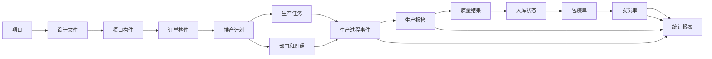

# 东吴云生产管理平台重开发数据流转说明

版本：0.1
日期：2026-10-22
用途：提供给重新开发东吴云生产管理平台的产品、架构、后端和前端团队

## 1. 文档目的

本文件把东吴云构件生产管理平台描述成一条可以重新实现的业务链路，重点说明数据在项目、订单、排产、生产、质检、入库、打包、发货和统计之间如何流转。开发团队应先理解数据关系和状态规则，再按接口、页面和数据库实现。

本文根据东吴云当前网页实际加载的前端路由、JavaScript 中的接口调用，以及登录后只读页面和接口核对结果整理。接口名称和字段名以当前平台为准；标记为“待联调”的内容，必须在新系统立项时通过真实样例和业务人员确认。

## 2. 已确认范围和证据等级

| 标记 | 含义 |
|---|---|
| 已确认 前端 | 当前东吴云前端实际引用了该页面、接口或字段 |
| 已确认 响应 | 已使用登录态调用到接口，并观察到返回结构或字段 |
| 业务推定 | 根据页面关系和接口命名推断，需业务方确认 |
| 待联调 | 当前没有足够样本，开发时必须补齐 |

已登录只读核对得到的事实包括：

- 登录后平台使用 `factory_token` Cookie，同时前端 API 请求带 `Token` 请求头。
- `v1.user/getInfo` 返回用户、角色、部门和权限信息，包含 `role_permission`、`department`、`is_admin`、`token_version` 等字段。
- `v1.project/getProjectSelect` 当前返回 131 个项目，项目项至少包含 `id`、`code`、`name`、`status`、`start_time`、`end_time`、`real_start_time`、`real_end_time`、`completed` 等字段。
- `v1.user/getBranchs` 返回部门树，当前响应有 16 个顶层节点，节点包含 `id`、`pid`、`name`、`is_production`、`director`、`children`、`user_count` 等字段。
- `v1.statistical/getStatisticalDelivery` 返回项目级发货统计，当前响应项包含 `project_id`、`project_name`、`amount_plan`、`amount_delivery`、`undelivery`、`percent`、`status` 等字段。
- 项目列表、订单列表、生产计划列表的返回外层都采用分页结构，至少包含 `count`、`list`、`page`、`size`。

## 3. 总体业务链路



新系统应把“构件”作为贯穿全流程的业务主对象，把项目、订单、计划、任务、报检、包装和发货作为构件在不同阶段的业务关系，而不是在每个模块各自复制一份构件数据。

## 4. 核心数据对象及关系

| 对象 | 作用 | 关键关系 | 主要时间 |
|---|---|---|---|
| 项目 Project | 项目主档和设计资料的归属 | 一个项目包含多个设计文件和构件 | 计划开始、计划结束、实际开始、实际结束、创建、更新 |
| 设计文件 File | 项目导入或查看的设计资料 | 归属于项目，可能生成或更新构件 | 上传、解析、更新时间 |
| 构件 Artifact | 生产、质检和发货的最小业务对象 | 属于项目，可进入订单、计划、任务、包装和发货 | 计划时间、生产事件时间、报检时间、入库时间、发货时间 |
| 订单 Order | 对项目构件的业务归集和交付范围 | 关联项目和一组构件 | 创建、提交、更新、关闭 |
| 排产 Scheduling | 在时间、部门、设计和生产范围上组织构件 | 关联项目、订单、部门和构件 | 排产创建、计划开始、计划结束、发送生产 |
| 生产计划 Plan | 生产执行的批次或计划单 | 关联排产、部门、任务和构件 | 创建、开始、完成、同步 |
| 生产任务 Task | 班组或车间实际执行的任务单 | 关联计划、部门、构件和二维码 | 下发、接收、完成、撤销 |
| 过程事件 Process Event | 记录生产状态的变化 | 关联构件、任务、操作者和部门 | 事件发生时间、记录时间、更新时间 |
| 报检 Inspection | 对生产结果发起检查 | 关联构件、任务、部门和质检结果 | 报检、检查、探伤、通过、驳回 |
| 包装单 Package | 将已具备发货条件的构件编组 | 关联项目、订单和构件 | 创建、装包、出包 |
| 发货单 Delivery | 记录实际交付 | 关联项目、订单、包装和构件 | 发货、车辆、收货、撤回 |
| 统计模板 Month | 保存月度统计的查询范围和组织方式 | 关联部门，按月、日、部门继续下钻 | 创建、统计月份、统计日期 |

### 4.1 主键和外键要求

新系统至少应保留以下关系字段：

- `project.id` 是项目主键；项目选择接口同时返回 `project_id` 或等价的项目 ID。
- `artifact.id` 是构件主键；构件在订单、计划、任务、报检、包装和发货明细中必须使用同一个稳定 ID。
- `order.id`、`scheduling.id`、`plan.id`、`task.id`、`inspection.id`、`package.id`、`delivery.id` 分别是业务单据主键。
- 关系表需要记录来源单据、目标单据、操作人、操作时间和撤销时间，不能只保存当前状态。
- 二维码或构件编码应唯一；同一构件的编码在任务单、报检和发货环节必须可以反查到构件主键。

## 5. 时间模型

### 5.1 三类时间必须分开

开发时不要只设置一个 `update_time`。至少区分：

1. **业务发生时间**：事情实际发生的时间，例如实际开工、实际完成、报检时间、质检时间、入库时间、发货时间。
2. **操作记录时间**：用户点击保存或提交的时间。
3. **数据同步时间**：从文件、外部系统或平台接口同步进来的时间。

同一条记录可能三者不同。例如，昨天完成生产，今天补录，业务发生时间应为昨天，操作记录时间是今天。

### 5.2 时间格式

当前网页筛选日期通常以毫秒时间戳转换为 Unix 秒后提交给接口：

```text
网页日期控件（毫秒） → 前端转换 → API Unix 秒
```

项目主数据中的时间字段也可能以字符串或时间戳返回。新系统应统一数据库存储为带时区的时间类型，同时在 API 层明确：

- 请求中的 `start_time`、`end_time` 是 Unix 秒还是毫秒；
- 日期筛选是闭区间还是左闭右开；
- “某天”按北京时间的 00:00:00 到次日 00:00:00 处理；
- 报表跨天、跨月时按照业务发生时间归属，而不是按照录入时间归属。

### 5.3 建议的时间字段

| 字段 | 含义 | 是否可修改 |
|---|---|---|
| `planned_start_time` | 计划开始 | 可调整，需留审计记录 |
| `planned_end_time` | 计划结束 | 可调整，需留审计记录 |
| `actual_start_time` | 实际开始 | 第一次确认后原则上不可覆盖 |
| `actual_finish_time` | 实际完成 | 允许撤销后重新完成，但保留历史 |
| `inspection_time` | 发起或完成质检时间 | 不应由列表更新时间代替 |
| `storage_time` | 入库时间 | 待联调确认具体来源 |
| `delivery_time` | 实际发货时间 | 发货单的业务时间 |
| `created_at` | 记录创建时间 | 不可修改 |
| `updated_at` | 最近一次修改时间 | 系统维护 |
| `synced_at` | 外部数据同步时间 | 系统维护 |

## 6. 分阶段数据流转、增量数据和校验

### 6.1 项目和设计文件

**入口接口**：

```text
v1.project/getList
v1.project/getInfo
v1.project/getProjectSelect
v1.project/getProjectFiles
v1.project/searchProjectFiles
v1.project/getProjectArtifacts
v1.project/downProjectDesign
v1.project/add
v1.project/edit
v1.project/del
```

**新增或变化的数据**：

- 新增项目主档：项目编号、项目名称、地址、负责人、计划日期、项目状态等。
- 新增或更新设计文件：文件名、文件版本、来源、解析状态、上传时间。
- 从设计文件解析或导入构件：构件编码、名称、规格、材质、数量、重量、所属项目等。

**必须校验**：

- 项目编号在有效范围内唯一。
- 设计文件版本不能覆盖正在使用的版本，替换必须产生版本记录。
- 构件编码在项目内唯一；若平台要求全局唯一，应在全局加唯一索引。
- 构件数量和重量不能为负数；单位必须明确。
- 删除项目前必须检查是否已有订单、排产、生产、报检或发货关系。

### 6.2 订单和订单构件

**接口**：

```text
v1.order/getList
v1.order/getInfo
v1.order/getAllOrder
v1.order/getOrderArtifacts
v1.order/getUnArtifacts
v1.order/submitArtifacts
v1.order/removeArtifacts
v1.order/downArtifacts
v1.order/downCodes
```

**新增或变化的数据**：

- 新增订单主档。
- 将项目构件加入订单，形成订单与构件关系。
- 订单提交后记录提交人、提交时间和订单状态。
- 下载构件清单或二维码文件时由服务端按当前订单状态生成文件。

**必须校验**：

- 只能选择属于当前项目的构件。
- 已经进入不可回退生产阶段的构件不能重复加入其他互斥订单。
- 订单内构件不能重复。
- 订单数量、重量应等于订单明细汇总；前端展示值以服务端汇总为准。
- 订单提交后是否允许移除构件，应由状态机控制，不能只靠按钮隐藏。

### 6.3 排产、部门和设计

**接口**：

```text
v1.production/getSchedulings
v1.production/getScheduling
v1.production/addScheduling
v1.production/editScheduling
v1.production/delScheduling
v1.production/getSchedulingDesign
v1.production/submitSchedulingArtifacts
v1.production/removeArtifacts
v1.production/setDepartment
v1.production/editDepartment
v1.production/setDesign
v1.production/sendProduce
```

**新增或变化的数据**：

- 新增排产单。
- 将订单构件加入排产单。
- 将构件分配给部门、车间或班组。
- 设置生产设计、工艺或图纸版本。
- 发送生产后形成生产计划或生产任务的来源关系。

**必须校验**：

- 排产构件必须来自有效订单或项目范围。
- 一个构件在同一时间不能被两个互斥的生产计划占用。
- 分配的部门必须是部门树中 `is_production` 有效的节点。
- 计划开始时间不能晚于计划结束时间。
- 设计版本必须存在且属于当前项目。
- `sendProduce` 前必须有项目、构件、部门、计划日期和生产设计等必要信息。

### 6.4 生产计划和生产任务

**接口**：

```text
v1.production/getPlans
v1.production/getPlan
v1.production/delPlan
v1.production/getPlanArtifacts
v1.production/getPlanUnCompleteArtifacts
v1.production/getProductionArtifacts
v1.production/getProductionTasks
v1.production/getTasks
v1.production/getTaskArtifacts
v1.production/getTaskArtifactsCodes
v1.production/exportProduction
v1.production/syncProduction
v1.production/getPlanArtifactsCodes
v1.production/getPlanArtifactCode
```

**生产文件和任务单接口**：

```text
v2.production/parserExcelData
v2.production/getArtifactData
v2.production/editArtifactData
v2.production/downTaskOrder
v2.production/downTaskOrderQr
v2.production/downTaskOrders
v2.production/downTaskPlans
```

**新增或变化的数据**：

- 生产计划主档。
- 计划与构件关系。
- 生产任务单及其二维码。
- 构件分配到班组或车间的执行关系。
- Excel 解析后的构件生产字段。
- 生产计划导出、任务单下载和同步记录。

**必须校验**：

- 任务构件必须属于对应计划。
- 任务单二维码必须唯一且能反查构件。
- 生产任务不能超过计划数量；计划剩余量应等于计划量减去有效完成量。
- 计划删除必须限制在未开始或可撤销状态。
- Excel 重复导入必须具备幂等键，例如项目、构件编码、文件版本和来源批次。

### 6.5 生产过程状态

**接口**：

```text
v1.production/updateProcess
v1.production/cancelProcess
```

生产过程必须采用状态转换和事件记录，而不是直接覆盖一列状态。建议记录：

```text
构件ID
任务ID
计划ID
部门ID
过程类型
旧状态
新状态
业务发生时间
操作人
操作时间
撤销人
撤销时间
备注
```

**建议的状态约束**：

```text
未开始 → 生产中 → 已完成
已完成 → 可报检
可报检 → 已报检 → 已质检
已质检 → 已入库 → 已包装 → 已发货
```

实际状态枚举仍需登录后逐项抓取确认。新系统必须支持：

- 只允许合法的前进转换；
- 撤销必须生成反向事件，不能物理删除历史；
- 已发货构件禁止回退到生产中；
- 过程事件的业务时间不能晚于记录时间，除非明确允许补录；
- 同一构件同一过程不能重复提交相同有效事件。

### 6.6 报检和质量验收

**接口**：

```text
v1.production/getInspections
v1.production/getInspectionInfo
v1.production/getInspectionArtifactsCodes
v1.production/downloadInspection
v1.production/downloadInspections
v1.production/hideInspection
v1.statistical/getStatisticalQuality
v1.statistical/getStatisticalQualityArtifacts
```

**新增或变化的数据**：

- 报检单主档。
- 报检构件明细。
- 待检查、探伤、已质检、通过、未通过等结果。
- 检查人、检查时间、质量备注和附件。

**必须校验**：

- 报检构件必须已达到可报检状态。
- 同一个构件同时只能存在一个有效的待处理报检记录，除非是复检。
- 未通过构件不能直接进入已入库或已发货状态。
- 质检结果必须有操作人和时间。
- 隐藏报检记录不能等同于删除，必须保留原因和审计记录。

### 6.7 入库、包装和发货

当前统计筛选明确区分：未入库、未发货、已入库、已出库。当前公开前端没有发现一组名称明确的独立 `storage` 或 `inventory` 写接口，因此入库状态的实际写入来源仍需联调确认。

**已确认的相关接口**：

```text
v1.order/getPackageList
v1.order/createPackage
v1.order/getPackageInfo
v1.order/getPackageArtifacts
v1.order/searchPackageArtifacts
v1.order/addPackageArtifacts
v1.order/removePackageArtifacts
v1.order/downPackageCodes
v1.order/delPackage
v1.order/getDeliverys
v1.order/getDeliveryHistory
v1.production/updateProcess
v1.production/syncProduction
```

**新增或变化的数据**：

- 入库记录或构件入库状态。
- 包装单及包装构件关系。
- 发货单、车辆或收货信息。
- 发货历史和撤回历史。

**必须校验**：

- 未通过质检的构件不能入库或发货。
- 未入库构件不能进入已发货状态，除非业务明确允许直发。
- 一个构件不能同时出现在两个有效包装单中。
- 发货数量不能超过订单数量、包装数量或入库数量。
- 发货后必须锁定构件的关键生产数据；修改应走更正流程。
- 发货撤回必须恢复可解释的状态，并留下撤回原因。

## 7. 统计和网页报表生成

### 7.1 实时统计页面

当前页面主要采用以下方式生成报表：

```text
页面条件
  → 日期转换和部门拼接
  → POST 统计接口
  → 服务端按构件、计划、生产、质量和发货状态聚合
  → 返回 headers、list、size、weight 等数据
  → 前端根据 headers 动态建表
```

前端主要负责筛选、动态列和表格展示，统计口径主要在后端。重新开发时不能只复刻页面字段，还必须把服务端聚合规则写成可测试的查询或统计服务。

### 7.2 统计接口

```text
v1.statistical/getStatisticalData
v1.statistical/getStatisticalTeamData
v1.statistical/getStatisticalTeamArtifacts
v1.statistical/getStatisticalDelivery
v1.statistical/getStatisticalArtifacts
v1.statistical/getStatisticalArtifactsByOpenid
v1.statistical/getStatisticalQuality
v1.statistical/getStatisticalQualityArtifacts
```

主要筛选维度：

- 项目
- 区域
- 部门或班组
- 订单状态
- 生产状态
- 入库和发货状态
- 开始时间和结束时间

### 7.3 各类报表下钻

| 报表 | 汇总接口 | 下钻参数 | 明细接口 |
|---|---|---|---|
| 数据统计 | `getStatisticalData` | 项目、部门、状态、时间 | 按页面实际明细接口补齐 |
| 班组统计 | `getStatisticalTeamData` | 班组 ID、类型 0/1/2 | `getStatisticalTeamArtifacts` |
| 发货统计 | `getStatisticalDelivery` | `delivery=0/1/2` | 构件统计页面接口 |
| 构件统计 | `getStatisticalArtifacts` | 项目 ID | 构件动态列明细 |
| 质量统计 | `getStatisticalQuality` | 部门、类型 0..4、时间 | `getStatisticalQualityArtifacts` |

类型值必须在新系统中做成枚举字典，不能只在前端硬编码数字。

### 7.4 月度统计

```text
v1.statistical/getMonthList
v1.statistical/addStatisticalMonth
v1.statistical/delStatisticalMonth
v1.statistical/getStatisticalMonth
v1.statistical/getStatisticalDay
v1.statistical/getStatisticalDays
v1.statistical/getStatisticalDayInfo
```

月度统计是三级查询：

```text
统计模板 → 某月 → 某日 → 某部门 → 构件或过程明细
```

开发时必须明确月度数据是实时重算还是保存快照。建议保存统计任务的筛选条件、生成时间、数据版本和结果快照，以便以后解释历史报表为什么与当前实时统计不同。

## 8. 关键校验矩阵

| 校验点 | 规则 | 失败处理 |
|---|---|---|
| 项目归属 | 构件、订单、计划、任务必须属于同一项目 | 拒绝提交，返回冲突明细 |
| 构件唯一 | 编码或二维码不能重复 | 拒绝导入或提交 |
| 计划数量 | 完成量不能超过计划量 | 拒绝过程完成 |
| 部门有效 | 只能分配到有效生产部门或班组 | 拒绝排产 |
| 状态顺序 | 不能跳过前置状态或逆向覆盖 | 要求走撤销或更正流程 |
| 质检前置 | 未完成生产不能报检，未通过不能入库/发货 | 拒绝操作 |
| 包装唯一 | 构件不能同时属于两个有效包装单 | 拒绝装包 |
| 发货上限 | 发货量不能超过可发货量 | 拒绝发货 |
| 时间顺序 | 结束时间不能早于开始时间；业务时间不能无理由晚于操作时间 | 拒绝或标记补录 |
| 并发控制 | 同一构件同时操作时只能成功一次 | 返回版本冲突并刷新 |
| 权限 | 用户只能操作其部门、项目和角色允许的数据 | 后端强制校验 |
| 审计 | 关键状态变化必须记录人、时间、原因 | 缺少审计信息不得提交 |

## 9. 建议的数据库结构

建议至少拆分为以下表或等价的数据模型：

```text
project
project_file
artifact
artifact_attribute
order
order_artifact
scheduling
scheduling_artifact
production_plan
production_task
task_artifact
process_event
inspection
inspection_artifact
quality_result
storage_event
package
package_artifact
delivery
delivery_artifact
organization
user
role
permission
statistical_template
statistical_snapshot
operation_audit
```

不建议在 `artifact` 表上直接覆盖所有历史状态。当前状态可以作为查询缓存，但必须以过程事件、质检事件、入库事件和发货事件作为可追溯事实来源。

## 10. API 设计要求

- 所有写接口必须返回业务码、消息、数据和可定位的失败明细。
- 列表接口统一返回 `count`、`list`、`page`、`size`。
- 动态报表接口明确 `headers` 的字段名、显示名、数据类型、单位、排序和合计规则。
- 日期参数统一规定秒或毫秒，不能同一系统混用。
- 所有状态码、统计类型和发货类型都提供字典接口或版本化枚举。
- 写接口应支持幂等键，尤其是 Excel 导入、同步、扫码报工和发货提交。
- 重要写接口需要返回变更后的主记录和状态，前端不自行猜测状态。
- 导出接口要记录导出条件、操作者和生成时间，文件内容应能追溯到数据版本。

## 11. 需要开发方在联调阶段确认的事项

1. `updateProcess` 的完整过程类型和合法状态转换表。
2. 入库、出库状态的实际写入接口和来源系统。
3. 订单、排产、生产计划、任务单的准确外键关系。
4. 构件数量、重量、面积等统计单位和小数精度。
5. 统计时间是按业务发生时间、状态更新时间还是同步时间。
6. 统计接口中 `headers` 的完整结构和每个动态列的计算公式。
7. 月度统计是否保存快照，以及历史数据修改后的处理规则。
8. 订单提交、发送生产、质检通过、入库和发货是否需要审批。
9. 撤销、退回、复检、发货撤回等异常流程。
10. 不同角色、部门和项目之间的数据权限边界。

## 12. 验收建议

开发方至少应准备以下可重复验收场景：

- 一个项目导入 10 个构件，验证项目、构件、订单数量一致。
- 同一构件重复加入订单、重复排产、重复装包，系统均应拒绝。
- 生产完成后报检，未通过时尝试入库和发货，系统应拒绝。
- 同一构件经过完成、撤销、重新完成，历史事件完整可追溯。
- 订单、排产、生产、质检、发货的数量和重量逐级核对。
- 跨天、跨月的过程事件在日报和月报中归属正确。
- 同时打开两个页面提交同一构件，只有一个请求成功。
- 导入同一生产文件两次，结果不重复。
- 按项目、部门、订单状态、生产状态、入库状态和发货状态筛选，列表合计与明细合计一致。
- 月度报表下钻到日期、部门和构件后，能够解释汇总数的来源。

## 附录 A 当前已发现的接口族

### 项目

```text
v1.project/getList
v1.project/getInfo
v1.project/getProjectSelect
v1.project/getProjectArtifacts
v1.project/getProjectFiles
v1.project/searchProjectFiles
v1.project/downProjectDesign
v1.project/add
v1.project/edit
v1.project/del
```

### 订单、打包、发货

```text
v1.order/getList
v1.order/getInfo
v1.order/getAllOrder
v1.order/getOrderArtifacts
v1.order/getUnArtifacts
v1.order/submitArtifacts
v1.order/removeArtifacts
v1.order/downArtifacts
v1.order/downCodes
v1.order/getPackageList
v1.order/createPackage
v1.order/getPackageInfo
v1.order/getPackageArtifacts
v1.order/searchPackageArtifacts
v1.order/addPackageArtifacts
v1.order/removePackageArtifacts
v1.order/downPackageCodes
v1.order/delPackage
v1.order/getDeliverys
v1.order/getDeliveryHistory
```

### 生产、任务单、报检

```text
v1.production/getSchedulings
v1.production/getScheduling
v1.production/addScheduling
v1.production/editScheduling
v1.production/delScheduling
v1.production/getSchedulingDesign
v1.production/getPlans
v1.production/getPlan
v1.production/delPlan
v1.production/getPlanArtifacts
v1.production/getPlanUnCompleteArtifacts
v1.production/getProductionArtifacts
v1.production/getProductionTasks
v1.production/getTasks
v1.production/getTaskArtifacts
v1.production/getTaskArtifactsCodes
v1.production/submitSchedulingArtifacts
v1.production/removeArtifacts
v1.production/setDepartment
v1.production/editDepartment
v1.production/setDesign
v1.production/sendProduce
v1.production/updateProcess
v1.production/cancelProcess
v1.production/exportProduction
v1.production/syncProduction
v1.production/getPlanArtifactsCodes
v1.production/getPlanArtifactCode
v1.production/getInspectionArtifactsCodes
v1.production/getInspections
v1.production/getInspectionInfo
v1.production/downloadInspection
v1.production/downloadInspections
v1.production/hideInspection
v2.production/parserExcelData
v2.production/getArtifactData
v2.production/editArtifactData
v2.production/downTaskOrder
v2.production/downTaskOrderQr
v2.production/downTaskOrders
v2.production/downTaskPlans
```

### 统计和报表

```text
v1.statistical/getStatisticalData
v1.statistical/getStatisticalTeamData
v1.statistical/getStatisticalTeamArtifacts
v1.statistical/getStatisticalDelivery
v1.statistical/getStatisticalArtifacts
v1.statistical/getStatisticalArtifactsByOpenid
v1.statistical/getStatisticalQuality
v1.statistical/getStatisticalQualityArtifacts
v1.statistical/getMonthList
v1.statistical/addStatisticalMonth
v1.statistical/delStatisticalMonth
v1.statistical/getStatisticalMonth
v1.statistical/getStatisticalDay
v1.statistical/getStatisticalDayInfo
v1.statistical/getStatisticalDays
```

### 附录 B 开发方应交付的设计成果

- 业务实体关系图和状态机图。
- 每个写接口的请求、响应和错误码文档。
- 每个统计报表的口径、公式和示例数据。
- 数据库表结构、索引和唯一约束。
- 操作审计和状态事件设计。
- 导入、同步、导出和任务单生成方案。
- 测试数据集及上述验收场景的自动化测试结果。
